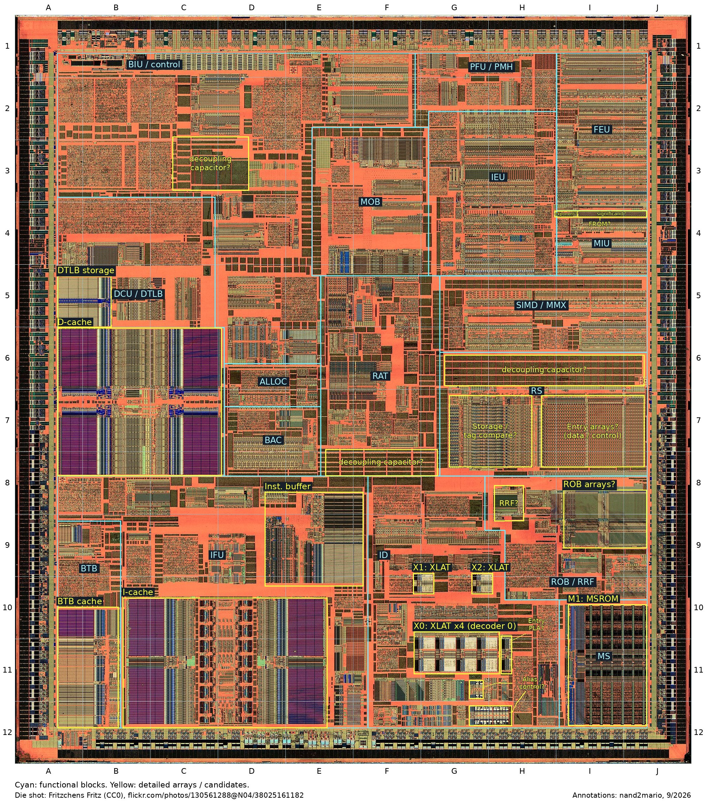
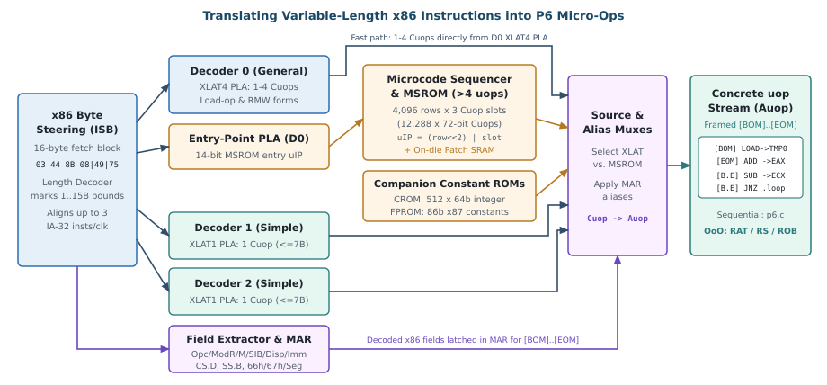
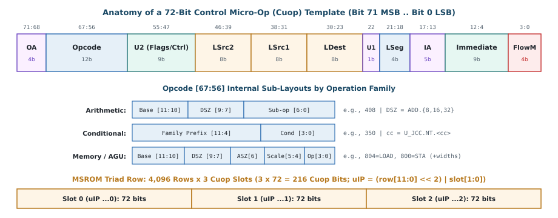
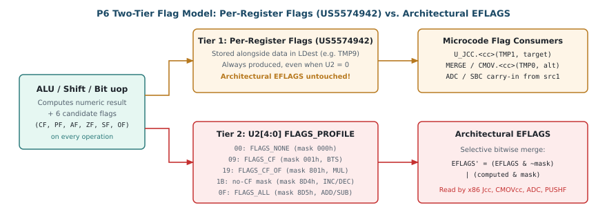
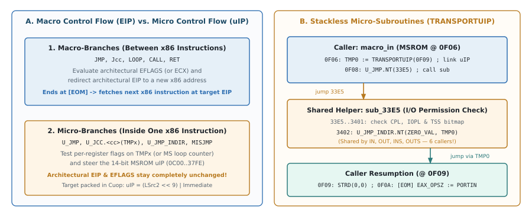
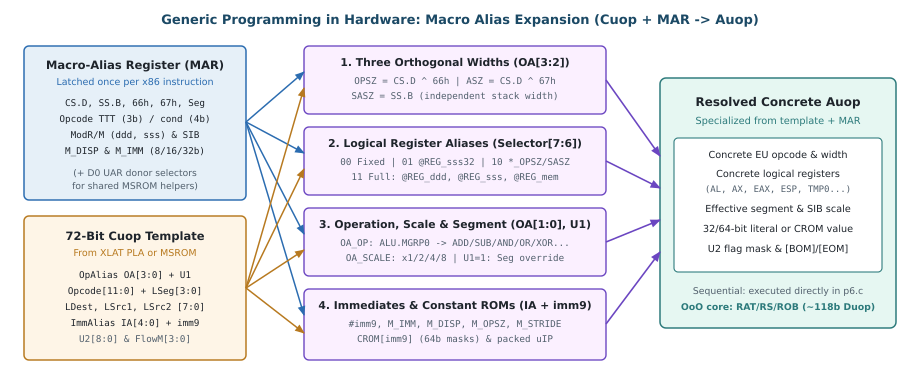

In the earlier [z386](../z386/) and [z486](../z486/) posts, we watched Intel's 32-bit x86 designs evolve from a microcoded state machine with [early-start](../80386_early_start/) overlap (386) into a tightly coupled 5-stage pipeline (486). Even on the dual-pipe Pentium (1993), what flowed down the pipeline was still recognizably an **x86 instruction**: decode logic resolved prefixes and addressing modes, walked the instruction through an in-order datapath, and retired results in lockstep.

With the **P6 microarchitecture**, introduced in the **Pentium Pro (1995)** and carried forward through Pentium II, Pentium III, and Pentium M, Intel changed things dramatically. Externally, a P6 chip still runs raw 16- and 32-bit IA-32 binaries. Internally, x86 instructions cease to exist after the decoder. Every instruction is translated into P6's private RISC-like instruction set: **micro-operations (`µop`s)**.

<figure style="width: 100%; max-width: 760px; margin: 24px auto 28px;">
<video controls preload="metadata" style="width: 100%; display: block; border-radius: 4px;" src="p6c-doom-quick.mp4"></video>
<figcaption style="text-align: center;">Booting MS-DOS, entering DOS/4GW 32-bit protected mode, and playing DOOM (<code>doom1.wad</code>, shown at 10× speed) on <code>p6.c</code>—a sequential C simulator of P6 micro-ops.</figcaption>
</figure>

<!--more-->

<style>
.cf { color: #005A9C; background: #EBF4FB; border: 1px solid #B3D4EC; border-radius: 3px; padding: 0 3px; font-weight: 600; }
.ua { color: #9A3412; background: #FFF3E6; border: 1px solid #F2C6A0; border-radius: 3px; padding: 0 3px; font-weight: 600; }
</style>

As with the earlier 386 and 486 posts, this series looks at the P6 microarchitecture through CPU internals and microcode—`µop`s in this case. Most textbook accounts jump straight from "x86 decodes into `µop`s" to Tomasulo register renaming, Reservation Stations, and Reorder Buffers; here we will focus on concrete microcode examples and RTL design.

As the *DOOM* run above demonstrates, P6's `µop` layer is a complete, self-contained execution architecture in its own right. It sits between the x86 architecture layer and the underlying out-of-order machine. And I think it is an important historical piece of technology to understand.

### Community Work on Understanding P6

During the past few months, I've built on existing community reverse-engineering efforts on Intel's P6 microcode architecture:

* **Peter Bosch (`peterbjornx`):** In 2020, Peter pioneered P6 microcode reverse engineering using a metallographic microscope—breaking the P6 microcode update format, 3-slot triad bit-scrambling, and internal [`CRBUS`](https://martin.hinner.info/p6microcode/wiki/crbus) access, and releasing [`p6tools`](https://github.com/peterbjornx/p6tools) (`uc_isa.py`, `descramble.py`, `simpledis.py`, `simpleas.py`) along with patch utilities (`patchtools`, without key material). His tweets and writeup ended with a classic nerd-snipe: *"Yep. If anyone wants to mess around with microcode, a lot of the tools are on github. Some assembly required but you should be able to get it to work."* (Feb 12, 2021)
* **Rudolf Marek (`ruik`):** Picked up that challenge around April 2025, reproducing Peter's work to achieve arbitrary microcode execution on a Pentium II (*Dixon*), then extending [`patchtools_pub`](https://github.com/ruikruik/patchtools_pub) and [`utools`](https://github.com/ruikruik/utools) (alongside [`microcode-patch-collection`](https://github.com/ruikruik/microcode-patch-collection)) with key material and ROM dumpers across Pentium Pro, Pentium II, Pentium III, Pentium M, and first-generation Intel Core processors—making it practical to dump internal ROMs, build accepted patches, and run custom microcode from Linux usermode or DOS.
* **Martin Hinner:** Joined Rudolf in August 2025, greatly extending the assembler, disassembler, and scrambler (`p6microcode-tools`) while spending extensive effort on cross-CPU analysis and on-hardware verification across P6-family processors, and creating the **[P6 Microcode Wiki](https://martin.hinner.info/p6microcode/wiki/)**, cataloguing P6 `µop` mnemonics (such as [`TRANSPORTUIP`](https://martin.hinner.info/p6microcode/wiki/TRANSPORTUIP), [`WUINSERT`](https://martin.hinner.info/p6microcode/wiki/WUINSERT), and [`SIGEVENT`](https://martin.hinner.info/p6microcode/wiki/SIGEVENT)), logical [register tables](https://martin.hinner.info/p6microcode/wiki/registers), `CRBUS` registers, and cross-stepping notes. He is also documenting [AMD microcode](https://martin.hinner.info/amdmicrocode/) and welcomes collaborators interested in helping extract AMD `MSROM`. *(While `p6microcode-tools` is not yet publicly released, Rudolf and Martin are happy to share it with anyone interested in collaborating on P6 microcode reverse engineering.)*

Intel's large body of P6-era patents was also very helpful—especially patents `US5721855`, `US5559974`, `US5627985`, `US5574871`, `US5680565`, and their companions (listed in the [references](#references)).

From there, the main way forward was **live Pentium Pro hardware experiments.** Nothing beats real hardware tests for settling ambiguities. The existence of the P6 microcode patching mechanism means I could change the microcode in any way I wanted—something not possible on the 386 or 486. So over 200 targeted microcode and architectural probes were built and executed on a physical **Pentium Pro (`CPUID 0619h`, stepping 9)** testbench to resolve undocumented field encodings and verify P6-specific behavior (unless noted otherwise, all `MSROM` excerpts and hardware measurements below come from this `CPUID 0619h` Pentium Pro). That turned out to be fruitful: my understanding of P6 `µop`s is now complete enough to write `p6.c`, a `µop`-based simulator that boots DOS and runs *DOOM*.

### Quick View of a P6 Die

Before zooming into individual `µop` bits, it helps to look at an actual P6 die to see two things at once: **where Intel spent its transistor budget** (5.5 million transistors on the original Pentium Pro core die, growing to 7.5 million on Pentium II with larger L1 caches and MMX), and **which blocks sit next to each other** because neighboring units communicate over tight, timing-critical wires:

<figure style="width: 100%; max-width: 920px; margin: 28px auto 32px;">
<a href="pentium2_rom_candidates.jpg"></a>
<figcaption style="text-align: center;">Functional blocks (cyan) and ROM/PLA/array candidates (yellow) on a P6-family die: <b>Deschutes</b> (250 nm Pentium II), with metal layers stripped to expose polysilicon transistor patterns (click for full resolution).<br>
<small>Base photograph: <a href="https://www.flickr.com/photos/130561288@N04/38025161182/">Fritzchens Fritz</a> (CC0).</small></figcaption>
</figure>

*(Note on chip generation: this photograph shows a 250 nm **Pentium II (Deschutes)** rather than the 350 nm **Pentium Pro (`CPUID 0619h`)** from which my ROM dumps come—for example, the `SIMD / MMX` block at `G5–I5` was added after Pentium Pro. Even so, Pentium II uses the same core P6 microarchitecture, making its floorplan an illuminating map of the machine.)*

At a quick glimpse, P6 is a world apart from the 1.2-million-transistor **i486** we studied in [`z486`](../z486/). On an i486 die, outside the 8 KB unified cache and x87 FPU, almost everything is a linear in-order datapath: a compact `D1`/`D2` decoder cracks one instruction at a time and drives the address adder, ALU, and microcode ROM in lockstep. On P6, by contrast, the actual arithmetic hardware occupies only a modest corner—most of the non-cache silicon goes into **decoupling variable-length x86 instructions from out-of-order execution**:

1. **Fetch & Branch Prediction (`A7–E12`, bottom-left):** The Instruction Fetch Unit (**`IFU`**, `C9`) sits wedged directly between the Branch Target Buffer (**`BTB`**, `A9–B12`), L1 **`I-cache`** (`B10–E12`), **`Inst. buffer`** (`D8–E9`), and Branch Address Calculator (**`BAC`**, `D7`), keeping predicted target steering and 16-byte instruction-block fetches on short local wires before aligned x86 bytes cross rightward into **`ID`**.
2. **x86-to-`µop` Translation & Microcode (`F8–J12`, bottom-right — our focus in this post):** Notice how much silicon P6 spends purely translating x86 bytes into `µop`s. Inside **`ID`** (`F8–H12`), you can spot the asymmetric **4 + 1 + 1 decoder `XLAT` PLA candidates**: four side-by-side PLAs at **`X0: XLAT x4`** (`G10–H11`, general decoder `D0`) and two single-`µop` PLAs above them at **`X1`** and **`X2`** (`G9–H9`, simple decoders `D1` and `D2`). Their immediate neighbors tell the rest of the story:
    * Directly touching `X0`'s right edge at `H10` sits the **`Entry PLA?`** candidate—matching patent `US5559974` Figure 5, where `XLAT` and the entry-point PLA share the same opcode inputs while the entry PLA steers **`M1: MSROM`** right next door (`I10–J12`).
    * Directly below `X0` (`G11–H12`) sit two **`Alias / control?`** array candidates, positioned right where `µop` templates from both `XLAT` and `MSROM` converge to be specialized with decoded instruction fields before heading north.
3. **Out-of-Order Bookkeeping Across the Center (`D6–J9`):** The entire middle band of the chip isn't arithmetic at all—it is dynamic-execution bookkeeping: **`ALLOC`** (`D6`), **`RAT`** register renaming (`E6–F7`), the 20-entry Reservation Station (**`RS`**, `G6–J7`), and the 40-entry Reorder Buffer and committed register file (**`ROB / RRF`**, `H8–J9`), bridging the bottom front end (`3 µop`s/cycle) upward to the execution units.
4. **Compact Execution Units (`G2–J5`, top-right):** Compared to caches, decode, and scheduling, the actual math units—integer **`IEU`** (`G2–H4`) and floating-point **`FEU`** (`I2–J3`, with the thin **`FROM?`** floating-point constant ROM candidate along `I4`'s upper edge)—take up surprisingly modest area right above **`RS`** and **`ROB / RRF`**.
5. **Memory Ordering & Data Cache (`A1–F8`, upper-left):** The Memory Order Buffer (**`MOB`**, `E2–F4`) sits at the crossroads between **`DCU / DTLB`** and L1 **`D-cache`** (`A5–C8`) on its left and the core execution engine to its southeast, tracking in-flight loads and stores before memory updates reach the cache.

So here we go. Let's head into the bottom-right corner of the die—**`ID`** and **`MSROM`**—and see how x86 instructions become `µop`s.

---

## 1. Translating Variable-Length x86 into Fixed `µop`s (`XLAT` vs. `MSROM`)

Why not execute x86 instructions directly, the way the 486 and Pentium did?

Consider three ordinary IA-32 instructions sitting back-to-back in a loop:

```nasm
03 44 8B 08    add eax, [ebx + ecx*4 + 8]   ; 4 bytes: memory load + 32-bit ALU add + EFLAGS
49             dec ecx                      ; 1 byte:  subtract 1, update 5 flags (keep CF!)
75 F9          jnz .loop                    ; 2 bytes: test ZF and redirect EIP
```

Directly pipelining instructions like these gets painful fast:

* **Variable length (1 to 15 bytes):** You don't know where instruction #2 starts until you have parsed all prefixes, opcode bytes, `ModR/M`, `SIB`, displacement, and immediate bytes of instruction #1.
* **Compound memory-plus-ALU work:** `add eax, [ebx + ecx*4 + 8]` computes a scaled address, checks segment limits and page permissions, reads 4 bytes from cache, adds them to `EAX`, and updates six status flags. Meanwhile `add [ebx], eax` reads memory, modifies the value, and writes memory back.
* **Asymmetric operand rules:** Registers can be 8-bit (`AL`, `AH`), 16-bit (`AX`), or 32-bit (`EAX`), implicit (`ESP` in `PUSH`, `ECX` in `LOOP`, `EDX:EAX` in `MUL`) or explicit.

P6's front end solves this by translating every x86 instruction into one or more **72-bit `µop` templates** that always follow a uniform RISC-like discipline: **at most two source registers, one destination register, and strictly separated memory loads, ALU operations, and memory stores**. (Following Intel's decoder patent `US5559974`, a raw 72-bit template from the decoder PLAs or ROM—still carrying alias control bits—is called a **`Cuop`**, and once instruction-specific fields are substituted in, the resolved operation is called an **`Auop`**.)

<figure style="width: 100%; max-width: 920px; margin: 28px auto 32px;">

<figcaption style="text-align: center;">From 16-byte x86 instruction blocks through the asymmetric 4-1-1 hardware decoders (<code>XLAT</code>), 3-slot <code>MSROM</code> triads, and the Macro-Alias Register (<code>MAR</code>) muxes into a uniform <code>[BOM]..[EOM]</code> <code>µop</code> stream.</figcaption>
</figure>

As shown above, P6 splits x86-to-`µop` translation across two hardware sources using an **asymmetric 4-1-1 decoder layout** (patent `US5630083`; Shen & Lipasti §7.3.3):

1. **Simple Decoders `D1` and `D2` (`1 µop` each):** Rather than paying the silicon area of three full x86 decoders, `D1` and `D2` only handle common, prefix-light instructions (≤ 7 bytes) that turn into a **single `Cuop`**—register-to-register math (`DEC ECX`), register loads (`MOV EAX, [EBP+8]`), `LEA`, and simple conditional jumps (`JNZ`).
2. **General Decoder `D0` (`XLAT4`, `1` to `4 µop`s):** `D0`'s combinational translation PLA (`XLAT4`) handles any x86 instruction up to **4 `Cuop`s** in a single clock—such as our 2-`µop` `ADD EAX, [EBX + ECX*4 + 8]` ([`LOAD`](https://martin.hinner.info/p6microcode/wiki/LOAD) + [`ADD`](https://martin.hinner.info/p6microcode/wiki/ADD)), a 3-`µop` `PUSH EAX`, or a 4-`µop` read-modify-write `ADD [mem], EAX`. (If a multi-`µop` instruction happens to land on `D1` or `D2`, hardware simply holds it for `D0` on the next cycle.)
3. **The Microcode Sequencer and `MSROM` (`> 4 µop`s):** When `D0` sees a complex instruction—anything from `CPUID`, `CMPXCHG`, `ENTER`, and `REP MOVS` up to `IRET` and x87 transcendentals like `FSIN`—`D0` hands a 14-bit starting microaddress (`µIP`) to the **Microcode Sequencer (`MS`)**, which fetches 72-bit `Cuop`s from the on-die **Microcode Sequencer ROM (`MSROM`)**.

Every x86 instruction takes one of three paths through `D0` and `MSROM`:

* **Pure `XLAT` (1–4 `µop`s):** Over 90% of dynamic instructions in typical integer programs (and in the *DOOM* run above) finish right inside `D0`/`D1`/`D2` without ever touching `MSROM`.
* **Hybrid `XLAT4` Prefix + `MSROM` Continuation:** To avoid wasting a cycle while `MSROM` is read, `D0` can emit up to four setup `Cuop`s from `XLAT4` on cycle `t` while `MSROM` seamlessly continues emitting the rest of the routine on cycle `t + 1`.
* **`MSROM`-Only:** Rare or serializing instructions (`CPUID`, `LGDT`, `HLT`, `LOCK` read-modify-write forms) jump straight to an `MSROM` entry point.

### Anatomy of a 72-Bit `Cuop`

Let's look at what sits inside one **72-bit `Cuop`** coming out of `XLAT` or `MSROM`—and how `MSROM` packs them into physical rows. *(Note: this reflects our **current working layout** for Pentium Pro `CPUID 0619h`, matching the [P6 Microcode Wiki `uops` reference](https://martin.hinner.info/p6microcode/wiki/uops). Several bitfields—particularly the upper bits of <code class="cf">U2</code> and certain field combinations—are still work-in-progress / TBD, and community contributions are very welcome! Throughout the rest of this post, <code class="cf">blue</code> highlights 72-bit `Cuop` fields and bit slices, while <code class="ua">amber</code> highlights actual `0619h` `MSROM` addresses.)*

<figure style="width: 100%; max-width: 920px; margin: 28px auto 32px;">

<figcaption style="text-align: center;">Top: The 11 fields of a 72-bit P6 control <code>µop</code> (<code>Cuop</code>). Middle: How the 12-bit <code>Opcode</code> encodes width, condition, or scale sub-fields by family. Bottom: Each <code>MSROM</code> triad row holds three 72-bit <code>Cuop</code> slots (<code>...0</code>, <code>...1</code>, <code>...2</code>).</figcaption>
</figure>

Even though 72 bits is wider than a 32-bit MIPS or RISC-V instruction, the 11 fields break down into five clean roles that we will meet throughout this post (the community names <code class="cf">U1</code> and <code class="cf">U2</code>—originally "unknown" control fields—are kept here for consistency with existing P6 microcode tools):

* **What to do (<code class="cf">Opcode [67:56]</code>, 12 bits):** Selects the execution primitive ([`ADD`](https://martin.hinner.info/p6microcode/wiki/ADD), [`LOAD`](https://martin.hinner.info/p6microcode/wiki/LOAD), [`STA`](https://martin.hinner.info/p6microcode/wiki/STA), [`U_JCC`](https://martin.hinner.info/p6microcode/wiki/U_JCC), ...) together with family-specific sub-fields for data width (`DSZ`), address width (`ASZ`), SIB scale (`Scale`), or branch condition (`Cond`).
* **Flag & modifier profile (<code class="cf">U2 [55:47]</code>, 9 bits):** Operation-dependent control bits—most importantly <code class="cf">U2[4:0]</code>, which selects which architectural `EFLAGS` bits (if any) an integer `µop` is allowed to overwrite (Section 2), while upper bits <code class="cf">U2[8:5]</code> and non-integer profiles carry additional controls (several still TBD).
* **Three register operands + segment (<code class="cf">LSrc2 [46:39]</code>, <code class="cf">LSrc1 [38:31]</code>, <code class="cf">LDest [30:23]</code> at 8 bits each; <code class="cf">LSeg [21:18]</code>, 4 bits):** Name up to two source registers, one destination register (architectural registers like `EAX`, internal scratch registers `TMP0`–`TMPE`, or discard target `SINK`), and the memory segment (`DS`, `SS`, `ES`, ...).
* **Immediate & constant steering (<code class="cf">Immediate [12:4]</code>, 9 bits + <code class="cf">IA [17:13]</code>, 5 bits):** <code class="cf">IA</code> (`ImmAlias`) steers the 9-bit <code class="cf">Immediate</code> field—selecting an inline signed literal (`#n`), a decoded x86 displacement/immediate, a 64-bit Constant ROM (`CROM`) entry, or even a 14-bit microbranch address `(` <code class="cf">LSrc2</code> `<< 9) |` <code class="cf">Immediate</code> (Section 3).
* **Template alias switches & framing (<code class="cf">OA [71:68]</code>, 4 bits + <code class="cf">U1 [22]</code>, 1 bit; <code class="cf">FlowM [3:0]</code>, 4 bits):** <code class="cf">OA</code> (`OpAlias`), <code class="cf">U1</code>, <code class="cf">IA</code>, and the upper bits of the operand fields let a single static `Cuop` act as a *generic hardware template* across operand widths and decoded x86 registers (Section 4), while <code class="cf">FlowM</code> frames x86 instruction boundaries.

**Physical packing and an address quirk:** Notice the bottom bar of the diagram as well. Because P6's core issues up to **three `µop`s per cycle**, both `MSROM` and the patchable `MSRAM` physically pack each triad of three 72-bit `Cuop`s into **7 × 32-bit words**—and the bits are **heavily scrambled** across two transformations (`MSROM` → `MSRAM` → logical `Cuop`). On the addressing side, `MSROM` holds **4,096 triad rows**, and P6's 14-bit `µIP` wire and branch-target encoding is bit-sliced into **`(row[11:0] << 2) | slot[1:0]`** (allowing micro-branches to target mid-triad slots `...1` and `...2` as well as `...0`). That is why hardware `µIP`s in the `MSROM` disassembly count `...0, ...1, ...2, ...4, ...5, ...6`, skipping every fourth hex address (`...3, ...7, ...B, ...F`).

### Keeping x86 Instructions Whole: `[BOM]` and `[EOM]`

Once a 4-`µop` `ADD [mem], EAX` or a 30-`µop` `ENTER` cracks into individual `µop`s, how does the CPU remember where one x86 macroinstruction begins and ends? That is the job of the 4-bit **<code class="cf">FlowM [3:0]</code>** field at the right end of every `Cuop`:

* **`[BOM]` (Beginning of Macroinstruction):** Marks the first `µop` of an x86 instruction.
* **`[EOM]` (End of Macroinstruction):** Marks the final `µop` of an x86 instruction. Only when `[EOM]` finishes does architectural `EIP` advance to the next x86 instruction, and only *between* `[EOM]` and the next `[BOM]` can ordinary external interrupts (`INTR`) or single-step traps (`TF`) fire.
* **`[BOM.EOM]`:** Both bits set—a single-`µop` x86 instruction such as `DEC ECX` or `ADD EAX, EBX`.

In my sequential `p6.c` simulator, executing one x86 instruction is as simple as fetching `Cuop`s from `[BOM]` through `[EOM]`, specializing any aliases into concrete `Auop`s, and updating architectural state cleanly when `[EOM]` completes.

---

## 2. Arithmetic, Flags, and Split Memory Ops

Now let's look at the `µop`s themselves. What primitives do `XLAT` and `MSROM` use to compute integer results, manage x86's notoriously finicky `EFLAGS`, and read or write memory?

### 2.1 Scratch Registers (`TMP0`–`TMPE`) and Load-Operate

Suppose P6 decodes `add eax, [ebx + ecx*4 + 8]`. An ALU `µop` cannot read memory directly, so `D0`'s `XLAT4` cracks the instruction into two `µop`s using one of P6's **15 named scratch registers (`TMP0`–`TMPE` in hex, plus discard target `SINK`)**. *(Interestingly, the exact physical bit widths of individual `TMP` registers—which ones are strictly 32-bit vs. wider 64/86-bit for floating-point packets—are still partially unknown and under active hardware investigation.)*

```asm
; Conceptual resolved Auop pair for: add eax, [ebx + ecx*4 + 8]
[BOM] TMP0 := LOAD.ASZ32.SC4.DSZ32(ECX, EBX, +0x08, SEG_DS) ; LSrc1 = scaled index (ECX*4), LSrc2 = base (EBX)
[EOM] EAX  := ADD.DSZ32(EAX, TMP0, FLAGS_ALL)
```

Notice the clean division of labor:

1. [`LOAD`](https://martin.hinner.info/p6microcode/wiki/LOAD) computes `EBX + ECX * 4 + 8` inside the Load Address Generation Unit, verifies `DS` segment limits and page read permissions, and places the 32-bit value from memory into `TMP0`.
2. [`ADD`](https://martin.hinner.info/p6microcode/wiki/ADD)`.DSZ32` adds `EAX + TMP0`, writes `EAX`, and updates all six architectural arithmetic flags (`CF, PF, AF, ZF, SF, OF`).

What if the destination is *memory* instead—`add dword ptr [ebx + ecx*4 + 8], eax`? Now `D0` emits a 4-`µop` read-modify-write sequence:

```asm
; Conceptual resolved 4-uop flow for: add [ebx + ecx*4 + 8], eax
[BOM] TMP0 := LOAD.ASZ32.SC4.DSZ32(ECX, EBX, +0x08, SEG_DS)
      TMP0 := ADD.DSZ32(TMP0, EAX, FLAGS_ALL)
      STRD.DSZ32(ZERO_VAL, TMP0)
[EOM] STA.ASZ32.SC4.DSZ32(ECX, EBX, +0x08, SEG_DS)
```

Look at the last two lines—**every memory store in P6 is split into two separate `µop`s**:

* **[`STRD`](https://martin.hinner.info/p6microcode/wiki/STRD) (Store Data):** Captures the value to be written in its second source slot (`TMP0`; its unused first source reads P6's hardwired zero operand `ZERO_VAL`).
* **[`STA`](https://martin.hinner.info/p6microcode/wiki/STA) (Store Address):** Computes the target address (`EBX + ECX*4 + 8`) and validates segment and page *write* permissions (`#GP`, `#SS`, `#PF`).

Even a humble `push ebp` is three `µop`s (`STRD` to supply `EBP`, `STA` to write `[ESP - 4]`, and [`SUB`](https://martin.hinner.info/p6microcode/wiki/SUB) to decrement `ESP` by `4`). In a sequential simulator like `p6.c`, splitting a store into `STRD` + `STA` looks like wasting cycles. In P6's out-of-order core, this actually helps performance. It lets hardware compute a store's *address* early, so younger loads immediately know whether they overlap that address while the store's *data* is still being calculated.

### 2.2 P6's Two-Tier Flag Model: Per-Register Flags vs. `EFLAGS`

While building `z386` and `z486`, I ran into two recurring headaches caused by `EFLAGS`:

1. **Microcode scratch math must never clobber user `EFLAGS`:** An instruction like `IN EAX, DX` or `LGDT [EBX]` is defined by Intel's manual to leave `EFLAGS` completely unchanged. Yet inside `MSROM`, `IN EAX, DX` has to shift port numbers, mask I/O permission bits, compare `CPL` against `IOPL`, and branch on the results. If internal `SUB` and `AND` `µop`s overwrote `EFLAGS`, microcode would constantly corrupt the running program's flags.
2. **Partial flag updates:** `ADD` and `SUB` update all six arithmetic flags (`CF, PF, AF, ZF, SF, OF`), `INC` and `DEC` update five flags **while preserving `CF`**, `MUL` updates `CF` and `OF`, and `BTS` updates **only `CF`**.

When I first disassembled the `MSROM`, lines like <code class="ua">0C0A</code>–<code class="ua">0C0C</code> looked baffling at first glance:

```asm
0C0A: TMP9 := BTEST.DSZ32(TMP9, #20)         ; U2 = 0 (no architectural flags!)
0C0C: U_JCC.NT.NC(TMP9, 11A0, IA_UADDR)      ; Branch to 11A0 if Carry Clear... on TMP9?!
```

Look closely at <code class="ua">0C0C</code>: [`U_JCC`](https://martin.hinner.info/p6microcode/wiki/U_JCC) does **not** read `EFLAGS`—it passes `TMP9` (written by [`BTEST`](https://martin.hinner.info/p6microcode/wiki/BTEST)) as an explicit source operand and branches on `TMP9`'s Carry flag, while architectural `EFLAGS.CF` stays completely untouched.

How does `TMP9` "have" a Carry flag? Intel's P6 execution-unit patent ([patent `US5574942`](https://patents.google.com/patent/US5574942A/en), Column 4 & Figure 4a) explains the layout directly: in P6, **every internal integer register and operand bus carries a 32-bit data field paired with a per-register `Flags` field (`OF, SF, ZF, AF, PF, CF`) holding the flags produced by the last operation that wrote that register** (and 86-bit floating-point registers similarly carry a 6-bit FP condition-code field in Figure 4b). In P6's out-of-order hardware, the Reorder Buffer (`ROB`) entry also stores `Data + Flags` side by side (patent `US5627985` Figure 4).

That gives P6 a clean **two-tier flag architecture**:

<figure style="width: 100%; max-width: 880px; margin: 28px auto 32px;">

<figcaption style="text-align: center;">Every arithmetic or bit <code>µop</code> writes six per-register flags alongside its destination value (Tier 1, patent <code>US5574942</code> Fig. 4a), while <code class="cf">U2[4:0]</code> selectively merges the desired subset into architectural <code>EFLAGS</code> (Tier 2).</figcaption>
</figure>

* **Tier 1 — Per-Register Flags (always produced):** Every ALU, shift, or bit-test `µop` writes the six flags it just computed directly into its destination register's `Flags` field (<code class="cf">LDest</code>, such as `TMP9`). Microcode branches (`U_JCC`), conditional moves (`CMOV`), and carry-chained operations read those flags straight off their <code class="cf">LSrc1</code> source register (patent `US5574942` Col. 4). By default (<code class="cf">U2</code> `= 0`, `FLAGS_NONE`), **nothing touches architectural `EFLAGS`**—microcode can subtract, test bits, and branch across multiple `TMP` registers in complete isolation.
* **Tier 2 — Masked Architectural Publication (<code class="cf">U2[4:0]</code>):** When an integer operation *is* supposed to update programmer-visible x86 `EFLAGS`, its `Cuop` sets an encoded 5-bit `FLAGS_PROFILE` index in <code class="cf">U2[4:0]</code> (not a direct bitwise mask—hardware decodes the 5-bit code into an architectural **`EFLAGS` bitmask**, matching patent `US6047369` Fig. 15C/17, and verified across all 32 <code class="cf">U2[4:0]</code> values on `0619h` hardware) and merges only the selected bits into `EFLAGS`:
    * <code class="cf">U2</code> `= 00h` (`FLAGS_NONE`, `EFLAGS` mask `000h`): per-register flags only (`LEA`, `MOV`, `NOT`, all internal microcode scratch work).
    * <code class="cf">U2</code> `= 09h` (`FLAGS_CF`, `EFLAGS` mask `001h`): updates `CF` only (`BTS`, `BTR`, `BTC`, `CLC`, `STC`).
    * <code class="cf">U2</code> `= 19h` (`FLAGS_CF_OF`, `EFLAGS` mask `801h`): updates `CF, OF` (`MUL`, `IMUL`, 1-bit `ROL`/`ROR`).
    * <code class="cf">U2</code> `= 1Bh` (`FLAGS_PF_AF_ZF_SF_OF`, `EFLAGS` mask `8D4h`): updates `PF, AF, ZF, SF, OF` while **keeping old `CF`** (`INC`, `DEC`).
    * <code class="cf">U2</code> `= 0Fh` (`FLAGS_ALL`, `EFLAGS` mask `8D5h`): updates all six arithmetic flags (`ADD`, `SUB`, `CMP`, `AND`, `OR`, `XOR`, `NEG`).

*(In the disassembly listings below, raw or operation-specific 9-bit <code class="cf">U2</code> codes without a symbolic alias print in hex as `U2.<hex>`, such as `U2.1B` on `INC`/`DEC` or `U2.21` on `MOVEMERGEFLGS`.)*

What about `ADC EAX, EBX` (Add with Carry), which needs to **read** the architectural `EFLAGS.CF` bit produced by an earlier x86 instruction? As patent `US5574942` Column 4 notes, [`ADC`](https://martin.hinner.info/p6microcode/wiki/ADC) takes its carry-in from the `Flags` field of its first source operand—so P6 bridges Tier 2 back into Tier 1 with an explicit flag-merge primitive, **`MOVEMERGEFLGS`** (seen directly in the `MSROM` disassembly at <code class="ua">2518</code>–<code class="ua">2519</code> for `LOCK ADC`, and mirrored in `p6.c`'s authored 2-`µop` `XLAT` template matching Intel AP-526's 2-`µop` count):

```asm
; Authored 2-uop XLAT flow in p6.c (matching AP-526 & MSROM @ 2518-2519): ADC @REG_ddd, @REG_sss
[BOM] TMP0     := MOVEMERGEFLGS(ArithFLAGS, @REG_ddd, U2.21)        ; attach EFLAGS.CF onto @REG_ddd's value
[EOM] @REG_ddd := ALU.@MGRP0.@DSZ(TMP0, @REG_sss, FLAGS_ALL)        ; ADC consumes TMP0's CF & updates EFLAGS
```

*(Don't worry yet about template markers like `@REG_ddd`, `@REG_sss`, `EAX_OPSZ`, or `.@DSZ` in these listings—for now just read `@` as "substituted from the decoded x86 instruction"; Section 4 explains them.)*

### 2.3 Branchless Microcode Idioms: `CMPXCHG` Without a Jump

Per-register flags unlock another neat trick: **branchless microcode**.

Consider `CMPXCHG r/m, r` (Compare and Exchange): compare `EAX` (or `AX`/`AL`) against the destination operand; if they are equal (`ZF = 1`), copy the source register into the destination; if they differ (`ZF = 0`), leave the destination alone and copy the destination's old value into `EAX`.

In C or assembly, you might reach for an `if`/`else` jump. In P6's `MSROM` (<code class="ua">2651</code>–<code class="ua">2656</code>), `CMPXCHG reg, reg` runs in **five straight-line `µop`s with zero branches**:

```asm
; MSROM disassembly for CMPXCHG @REG_sss, @REG_ddd (MSROM @ 2651)
macro_cmpxchg_reg:
2651: TMP1     := SUB.@DSZ?(EAX_OPSZ, @REG_sss, FLAGS_ALL)        ; Compare EAX - dest; publish EFLAGS & set TMP1's ZF
2652: TMP0     := MERGE(TMP1, @REG_ddd)                           ; Pair TMP1's flags (ZF) with replacement value @REG_ddd
2654: @REG_sss := CMOV.Z(TMP0, @REG_sss)                          ; If ZF=1, dest := @REG_ddd; else keep old @REG_sss!
2655: TMP2     := MERGE(TMP1, EAX_OPSZ)                           ; Pair TMP1's ZF with current EAX (handles dest == EAX!)
2656: [EOM] EAX_OPSZ := CMOV.Z(TMP2, @REG_sss)                    ; If ZF=1, keep EAX; else EAX := old @REG_sss!
```

Look how clean that is:

1. <code class="ua">2651</code> subtracts destination `@REG_sss` from accumulator `EAX_OPSZ`, publishing architectural `EFLAGS` (`FLAGS_ALL`) *and* recording the comparison's `ZF` bit in `TMP1`'s per-register flags.
2. `MERGE(flag_src, data_src)` (opcode `0E0h`, related to [`WUMERGE`](https://martin.hinner.info/p6microcode/wiki/WUMERGE)`.FLAGS` in patent `US5574942` Col. 14) pairs `TMP1`'s flags with `@REG_ddd`'s numeric value in `TMP0`.
3. `CMOV.Z(TMP0, @REG_sss)` inspects `TMP0`'s `ZF` bit: on equality (`ZF = 1`) it selects `TMP0`'s value (`@REG_ddd`); on mismatch (`ZF = 0`) it selects `@REG_sss`.
4. Lines <code class="ua">2655</code>–<code class="ua">2656</code> repeat the exact same `MERGE` + `CMOV.Z` pattern to update `EAX_OPSZ`—and reading `EAX_OPSZ` *after* <code class="ua">2654</code> even handles the tricky corner case `CMPXCHG EAX, EBX` where the destination operand aliases `EAX` itself.

The memory form (`CMPXCHG [mem], reg`, including `LOCK CMPXCHG`) benefits even more from this branchless `CMOV` idiom. As Intel's SDM notes, to keep the bus interface simple, the processor *always* issues a write cycle to the destination regardless of whether the comparison succeeds—writing back the old value on mismatch so that a locked read is never emitted without a matching locked write. Selecting either the new or old value with `CMOV.Z` feeds that unconditional store directly without a single branch.

---

## 3. Two Control Flows: Macro `EIP` vs. Micro `µIP`

Because P6 has both an x86 instruction stream *and* internal `MSROM` microprograms, control flow exists at two strictly separate levels. Remember that `µop`s execute out of order—and that has interesting ramifications for how control flow is designed.

<figure style="width: 100%; max-width: 900px; margin: 28px auto 32px;">

<figcaption style="text-align: center;">Left: Macro-branches move architectural <code>EIP</code> between x86 instructions, whereas micro-branches steer the 14-bit <code>µIP</code> inside <code>MSROM</code>. Right: Stackless micro-subroutine linkage via <code>TRANSPORTUIP</code> and <code>U_JMP_INDIR</code>.</figcaption>
</figure>

### 3.1 Macro-Branches: Moving Architectural `EIP`

Ordinary x86 control-transfer instructions work much like they did on the 386 and 486:

* **Conditional and unconditional relative jumps (`Jcc rel`, `JMP rel`):** Decode into a **single `[BOM.EOM]` branch `µop`**. In `JNZ .loop`, the Jump Execution Unit checks `EFLAGS.ZF`; if `ZF == 0` (the previous result was non-zero), it sets next `EIP` to `EIP + rel` instead of falling through to `EIP + len`.
* **Near `CALL` and `RET`:** Combine stack memory `µop`s with an `EIP` transfer:
    * `CALL rel32` pushes the return `EIP` onto the stack (`STRD` + `STA` to `[ESP - 4]`, plus `ESP := ESP - 4`) and redirects fetch to `EIP + rel32`.
    * `RET` pops the return address from `[ESP]` into `TMP0` (`LOAD`), increments `ESP` by `4` (`ADD`), and jumps to `TMP0` via `[EOM] M_RET`.
    * Even better, look at `RET imm16` (pop return IP and release `imm16` bytes of stack arguments) or `CALL reg` in the `MSROM` disassembly: `D0`'s `XLAT4` emits the stack memory/pointer `µop`s on cycle 1, then seamlessly continues into a **one-line `[EOM]` `MSROM` tail** (<code class="ua">0F71</code>`: [EOM] M_RET(..., TMP0)` for `RET imm16`, or <code class="ua">1165</code>`: [EOM] M_CALL_INDIR(..., @REG_sss)` for `CALL reg`) on cycle 2.

Here's a concrete example. This 12-byte real-mode snippet computes `5 + 3 + 2 + 1 = 11` (`0x0B`) in `AX` and halts—every instruction in the setup and loop body decodes into a single `XLAT` `µop`:

```nasm
0000: B8 05 00    mov ax, 5        ; 1 XLAT uop:  AX := 5
0003: B9 03 00    mov cx, 3        ; 1 XLAT uop:  CX := 3
.loop:
0006: 01 C8       add ax, cx       ; 1 XLAT uop:  AX := AX + CX (FLAGS_ALL)
0008: 49          dec cx           ; 1 XLAT uop:  CX := CX - 1  (U2.1B: PF..OF, keep CF)
0009: 75 FB       jnz .loop        ; 1 XLAT uop:  if !ZF, EIP := 0006
000B: F4          hlt              ; MSROM @ 25EC
```

### 3.2 Micro-Branches Inside `MSROM`: Moving `µIP` in an Out-of-Order Core

The way control flow works at the `µop` level, however, is more subtle—and the reason comes straight down to **out-of-order execution**.

On an in-order microcoded CPU like the 386, the microsequencer and ALU step in lockstep: a micro-branch tests the ALU flags just produced and immediately picks the next ROM address. On P6, by contrast, the Microcode Sequencer (`MS`) sits in the **in-order front end**, pumping up to three `Cuop`s per cycle into the Reservation Station *many cycles before* those `µop`s actually execute.

How can `MS` branch on a `TMP` register whose value hasn't even been computed yet? As Intel's branch-handling patent (patent `US5729728`) explains, P6 treats **micro-branches** just like macro-branches—sending them into the Reservation Station and **Jump Execution Unit (`JEU`)** tagged with a 1-bit `Mu` (Macro/Micro) flag so they steer the 14-bit **`µIP`** while leaving architectural `EIP` untouched:

* **[`U_JMP`](https://martin.hinner.info/p6microcode/wiki/U_JMP)`.NT(target)`:** Unconditional direct jump to a 14-bit `MSROM` address. Notice a clever bit-packing trick in the 72-bit `Cuop`: because an unconditional jump has no <code class="cf">LSrc2</code> register to read, P6 concatenates `(` <code class="cf">LSrc2</code> `<< 9) |` <code class="cf">Immediate</code> (`IA_UADDR`) to encode a full microaddress without widening the 9-bit <code class="cf">Immediate</code> field.
* **[`U_JCC`](https://martin.hinner.info/p6microcode/wiki/U_JCC)`.<T|NT>.<cc>(TMPx, target)`:** Conditional micro-branch testing a per-register flag (`Z`, `NZ`, `C`, `NC`, etc.) on `TMPx`. Because `MS` cannot stall waiting for `TMPx` to execute out of order, every `U_JCC` carries a **static prediction bit (`.T` taken or `.NT` not-taken)** in its opcode: `MS` immediately keeps fetching along that predicted `µIP` path, and if `JEU` later evaluates `TMPx` and finds the static hint was wrong, `JEU` flushes the front end (`JEClear`) and restarts `MS` at the right `µIP`.

### 3.3 Why P6 Has No Microcode Call Stack (`TRANSPORTUIP`)

Now consider microcode **subroutines**. Large `MSROM` flows share dozens of helper functions—checking I/O permission bitmaps, validating segment descriptors, or dispatching `RDMSR`/`WRMSR` addresses. On an in-order microcoded CPU (like the 386 or a classic VAX), you simply put a small 2- or 4-entry hardware return-address stack inside the microsequencer.

Why didn't P6 do that? Look at what happens to a hardware call stack inside `MS` once `µop`s execute **speculatively and out of order**:

* **Speculative pushes and pops:** `MS` fetches and issues microcode *ahead* of execution—potentially down a mispredicted macro-branch (`Jcc`) from the `BTB`, or past unresolved `U_JCC` hints inside `MSROM` itself. Worse, in `JEU`, a younger branch can even execute *before* an older branch (patent `US5729728` Figs. 7b–7c), or a memory `µop` halfway through a subroutine can page-fault (`#PF`) at retirement. If `MS` pushed and popped a dedicated hardware stack at issue time, every branch misprediction or fault flush would leave that stack out of sync unless P6 built full checkpoint-and-rollback hardware for it.
* **Why macro `CALL` / `RET` in 3.1 was easy by comparison:** Architectural x86 `CALL` and `RET` don't keep their authoritative state in a hidden front-end stack either—they emit ordinary `µop`s that write the return `EIP` into `[ESP]` (buffered safely in the `MOB` store buffer with renamed `ESP`) and `LOAD` it back into `TMP0`. (The `BTB`'s Return Stack Buffer is purely a speculative *hint* verified by `JEU`.) Microcode, of course, cannot push internal `µIP`s onto the user program's `[ESP]` stack.

Instead, P6 uses the exact same link-register idea as RISC architectures (`jal ra, target` / `jr ra`), storing return `µIP`s in **ordinary `TMP` registers** (right half of the diagram above; see the [`TRANSPORTUIP` entry on Martin Hinner's P6 wiki](https://martin.hinner.info/p6microcode/wiki/TRANSPORTUIP)):

1. **`TMPx :=` [`TRANSPORTUIP`](https://martin.hinner.info/p6microcode/wiki/TRANSPORTUIP)`(return_uip)`:** Materializes a 14-bit literal `MSROM` return address into any general temporary register (`TMP0`, `TMP8`, `TMPE`, ...), immediately followed by `U_JMP` to the helper.
2. **[`U_JMP_INDIR`](https://martin.hinner.info/p6microcode/wiki/U_JMP_INDIR)`.NT(ZERO_VAL, TMPx)`:** At the end of the shared helper, an indirect micro-jump reads the return `µIP` out of `TMPx` in `JEU` and redirects `MS` back to the caller.

By turning a return address into ordinary `TMP` register data, **P6 gets out-of-order subroutine tracking and rollback for free from its existing register renamer (`RAT` + `ROB`)**: each `TRANSPORTUIP` allocates a fresh `ROB` entry, `U_JMP_INDIR` waits in the Reservation Station until that `ROB` entry is ready, and any branch misprediction or fault flush automatically discards speculative `TMP` writes with zero extra sequencer state.

Look at `IN EAX, DX` (`macro_in` at <code class="ua">0F06</code> in the `MSROM` disassembly, ending with [`PORTIN`](https://martin.hinner.info/p6microcode/wiki/PORTIN) at <code class="ua">0F0A</code>) calling the shared I/O permission helper `sub_33E5` (<code class="ua">33E5</code>)—a single helper shared by six different callers (`IN`, `OUT`, `INS`, `OUTS`, and their `REP` variants):

```asm
; D0 XLAT4 prefix prepares port (TMP1 := zero_ext(DX)) and byte width (TMP2 := 1/2/4)
; Then MSROM continues at 0F06:
macro_in:
0F06: TMP0 := TRANSPORTUIP(0F09)                ; Save return microaddress 0F09 into TMP0
0F08: U_JMP.NT(33E5)                            ; Jump to shared I/O permission helper sub_33E5
...
sub_33E5:                                       ; Shared by 0F08, 1850, 18C8, 21DC, 261C, 2631
33E5: TMP3 := MOVE.DSZ32(ZERO_VAL)
33E6: TMP7 := MOVE.DSZ32(#1)
33E8: TMP4 := PSELECT_IO_BITMAP(TMP3, TMP7)     ; Hardware mode predicate: real mode / CPL<=IOPL vs VM86/bitmap
33E9: U_JCC.T.NZ(TMP4, 33FA, IA_UADDR)          ; Static .T hint: allowed -> skip TSS bitmap walk
...                                             ; [33EA..33F9: walk TSS I/O permission bitmap; #GP if denied]
@sub_33E5_permission_return:
...                                             ; [33FA..3401: finalize macro IP / helper cleanup]
3402: U_JMP_INDIR.NT(ZERO_VAL, TMP0)            ; Return to caller (0F09)
...
@macro_in_permission_return:
0F09: STRD.DSZ32(#0, #0)                        ; Dummy store-data companion paired with PORTIN in the MOB
0F0A: [EOM] EAX_OPSZ := PORTIN.ASZ16.SC1.@DSZ?(ZERO_OFFSET, TMP1, SEG.1)
```

Need a nested subroutine call inside another subroutine? An outer routine simply saves its return `µIP` in `TMPE` while the inner call uses `TMP8`—renamed independently in the `ROB` with zero hardware stack-depth limits.

---

## 4. Generic Programming with Micro-Ops: Macro Aliasing

Look back at the microcode excerpts we just read (`CMPXCHG` at <code class="ua">2651</code> and `IN` at <code class="ua">0F0A</code>), and notice the `@`-marked operands and opcode modifiers:

* `@REG_sss` and `@REG_ddd` instead of `EBX` or `ECX`
* `EAX_OPSZ` instead of `AL`, `AX`, or `EAX`
* `SUB.@DSZ?(...)` and `PORTIN.ASZ16.SC1.@DSZ?(...)` instead of fixed `DSZ8`, `DSZ16`, or `DSZ32`

If you have ever written a generic function in C++ (`template <typename T>`) or Rust (`fn cmpxchg<T>(...)`) so you don't have to copy-paste the same algorithm for `u8`, `u16`, and `u32`, you already understand what P6's microcode engineers built in silicon.

Count the combinatorial explosion of x86 encoding if every `XLAT` entry and `MSROM` routine had to hardcode concrete registers and widths. Take a single instruction family like `LOCK INC [mem]` and `LOCK DEC [mem]`:

* **2** operations (`INC` vs. `DEC`)
* **3** data widths (`BYTE` 8-bit, `WORD` 16-bit, `DWORD` 32-bit, toggled by opcode bit `W` and the `66h` prefix relative to `CS.D`)
* **2** address widths (`16-bit` `[BX+SI]` vs. `32-bit` `[EBX+ESI*4]`, toggled by `67h` relative to `CS.D`)
* **4** SIB index scales (`×1, ×2, ×4, ×8`) across **8** base registers and **8** index registers
* **6** possible segment overrides (`ES:`, `CS:`, `SS:`, `DS:`, `FS:`, `GS:`)

Multiplying those combinations produces **tens of thousands of legal x86 encodings**—yet the entire Pentium Pro `MSROM` holds only **12,288 `Cuop` slots** (`8,448` in the main factory ROM region <code class="ua">0C00</code>–<code class="ua">37FE</code>) for the *entire* IA-32 + x87 architecture.

### 4.1 From the 386 to P6: Instantiating `Cuop` Templates with `MAR` (Patent `US5559974`)

Size-generic microcode wasn't new to Intel—as we saw in [`z386`](../z386/), the **80386** already parameterized its 37-bit microcode to share routines across operand sizes and encodings:

* Symbolic register endpoints (`SRCREG`, `DSTREG`) resolved from `ModR/M`, plus size-sensitive names like `eAX_AL` vs. `EAX` and `eIP` vs. `EIP` vs. `IP`,
* Opcode-derived ALU and shift operations (`+-&|^`, `<<>>?`), and
* A runtime `op_size` latch (`8/16/32`-bit) initialized by the decoder—which 386 microcode could even override mid-routine (`BITS8`/`BITS16`/`BITS32`) and restore (`BITSDE`)—while hardwired front-end logic implicitly computed effective addresses (`EA`) before `RD` ever ran.

Why couldn't P6 keep doing it the 386 way? Once again, **out-of-order execution changes the contract**:

1. **Every `µop` in flight must be self-contained:** On the in-order 386, the datapath executed one micro-instruction at a time for a single active x86 instruction, so the ALU could simply consult a global `op_size` register. On P6, the Reservation Station holds up to 20 `µop`s from *many different x86 instructions at once*—mixing 8-, 16-, and 32-bit operations, different `ModR/M` registers, and different segments out of order. Execution units (`IEU`, `AGU`) cannot peek back at decoder latches or share a mutable `BITS16`/`BITS32` flip-flop; **every `µop` entering `RAT` must already carry concrete registers and widths.**
2. **Unified `XLAT` + `MSROM` templates with explicit addressing:** On P6, fast-path decoders (`XLAT`) and `MSROM` emit the exact same 72-bit `Cuop` format, and there is no separate pre-execution `EA` box hiding before `RD`—memory `µop`s (`LOAD`, `STA`, [`LEA`](https://martin.hinner.info/p6microcode/wiki/LEA)) must explicitly name their resolved base/index registers, scale, displacement, and segment.

P6 solves both problems by moving all template specialization **into a combinational expansion stage right after `XLAT` and `MSROM`**. Every 72-bit `Cuop` is treated as a **stateless generic template**, instantiated on the fly by a decoder latch called the **Macro-Alias Register (`MAR`)** (detailed in Intel's alias-expansion patent, patent `US5559974`):

<figure style="width: 100%; max-width: 920px; margin: 28px auto 32px;">

<figcaption style="text-align: center;">How the decoder's latched Macro-Alias Register (<code>MAR</code>) instantiates a 72-bit <code>Cuop</code> template across widths, logical registers, operations/segments, and immediates into a concrete <code>Auop</code>.</figcaption>
</figure>

When the Instruction Decoder parses an x86 instruction, a parallel **Field Extractor** latches the instruction's decoded parameters into `MAR` and holds them steady for the entire macroinstruction (from `[BOM]` to `[EOM]`):

* Active code/stack defaults (`CS.D`, `SS.B`) and `66h` / `67h` / segment-override prefixes,
* The primary opcode's 3-bit ALU code (`TTT`) or 4-bit condition code (`tttn`),
* `ModR/M` (`mod`, `reg`/`ddd`, `rm`/`sss`) and `SIB` (`scale`, `index`, `base`),
* The extracted memory displacement (`M_DISP`) and immediate (`M_IMM`).

As each 72-bit `Cuop` leaves `XLAT` or `MSROM`, combinational **Alias Muxes** substitute fields from `MAR` whenever the `Cuop`'s alias control bits (<code class="cf">OA</code>, <code class="cf">Selector[7:6]</code>, <code class="cf">U1</code>, <code class="cf">IA</code>) ask for them—producing a concrete **Alias-resolved `µop` (`Auop`)**.

Let's tour the four things `MAR` can specialize on the fly.

### 4.2 Dimension 1: Three Orthogonal Widths (`OPSZ`, `ASZ`, and `SASZ`)

x86 actually has three independent width settings. Suppose a 32-bit protected-mode program (`CS.D = 1`) whose stack segment happens to be 16-bit (`SS.B = 0`) executes `66 67 FF 33` (`PUSH WORD PTR [BX]`):

1. **`OPSZ` (Operand Size = `CS.D ^ 66h` = 16-bit):** It reads and pushes **2 bytes** of data.
2. **`ASZ` (Address Size = `CS.D ^ 67h` = 16-bit):** It forms the source address from 16-bit **`[BX]`**, not `[EBX]`.
3. **`SASZ` (Stack Address Size = `SS.B` = 16-bit):** It decrements and indexes **`SP`**, not `ESP`—and notice `SASZ` ignores both `66h` and `67h`.

Now remove `67h` (`66 FF 33`, `PUSH WORD PTR [EBX]`): `OPSZ` is 16-bit, `ASZ` is **32-bit** (`[EBX]`), and `SASZ` is still **16-bit** (`SP`).

P6 keeps `OPSZ`, `ASZ`, and `SASZ` as **three completely independent width wires** in `MAR` (verified across all eight raw data-size codes on `0619h` hardware). Setting the `OpAlias` data-size bit (<code class="cf">OA[2]</code> `= 1`, marked with `@` directly on the size modifier such as `.@DSZ?` / `.@DSZ16`, or trailing `.@DSZ`) or address-size bit (<code class="cf">OA[3]</code> `= 1`, marked `.@ASZ32` / `.@ASZ16` or `.@ASZ`) lets each individual `Cuop` pick *which* of the three contexts (`OPSZ`, `ASZ`, or `SASZ`) governs its data width and address width while keeping the raw template bits visible.

### 4.3 Dimension 2: Logical Register Aliases (<code class="cf">Selector[7:6]</code>)

Every `Cuop` has three 8-bit register fields: <code class="cf">LDest</code>, <code class="cf">LSrc1</code>, and <code class="cf">LSrc2</code>. Just looking at the top two bits (<code class="cf">Selector[7:6]</code>) tells the Alias Muxes how to resolve the register view (see also the wiki's [registers table](https://martin.hinner.info/p6microcode/wiki/registers)):

| Bits <code class="cf">[7:6]</code> | Selector Class | Examples in Disassembly | How `MAR` Resolves It |
| :---: | :--- | :--- | :--- |
| **`00`** | **Direct (Fixed)** | `EAX`, `AL`, `AX`, `TMP0`..`TMPE`, `CONST`, `SINK` | No alias—uses the exact register and width encoded in the `Cuop`. |
| **`01`** | **Identity Alias, Fixed Width** | `@REG_sss16`, `@REG_sss32`, `ST(i)` | Register *number* (`0..7`) comes from `ModR/M`, but width stays fixed (e.g., `MOV CR0, EAX` always uses 32-bit `@REG_sss32` even in 16-bit real mode). |
| **`10`** | **Fixed Register, Size Alias** | `EAX_OPSZ`, `ECX_ASZ`, `ESP_SASZ` | Register identity is fixed (`A`, `C`, or `SP`), while width (`8/16/32`-bit) tracks byte-opcode / `OPSZ`, `ASZ`, or `SASZ`. |
| **`11`** | **Full Identity + Size Alias** | `@REG_ddd`, `@REG_sss`, `@REG_op`, `@REG_mem` | **Both** register identity and width come from `MAR`. `@REG_ddd` automatically becomes `AL..BH` on byte opcodes, `AX..DI` when `OPSZ=16`, and `EAX..EDI` when `OPSZ=32`. `@REG_mem` expands <code class="cf">LSrc1</code> to the index register and <code class="cf">LSrc2</code> to the base register across both 16-bit `[BX+SI]` and 32-bit `[EBX+ESI*scale]` modes. |

Look how much work `ESP_SASZ` and `EAX_OPSZ` save: `PUSH` templates simply address `[ESP_SASZ]` and subtract `M_OPSZ` from `ESP_SASZ`, automatically handling 16-bit `SP` stacks and 32-bit `ESP` stacks with zero branches.

### 4.4 Dimension 3: Operation, Scale, and Segment Aliases (<code class="cf">OA[1:0]</code> & <code class="cf">U1</code>)

P6 doesn't just alias registers and widths—it can **alias the opcode itself**:

* **`OA_OP` (<code class="cf">OA[1]</code> `= 1`, `.@MGRP0` / `.@OP`):** Written `ALU.@MGRP0.@DSZ` in the disassembly (combining <code class="cf">OA[1]</code> + <code class="cf">OA[2]</code>, raw <code class="cf">OA</code> `= 6`), this replaces base opcode [`MOVE`](https://martin.hinner.info/p6microcode/wiki/MOVE) with the macroinstruction's decoded arithmetic operation (`ADD`, `OR`, `ADC`, `SBB`, `AND`, `SUB`, `XOR`, `INC`, `DEC`, or `BTS`/`BTR`/`BTC`). That means `ADD r, [m]`, `SUB r, [m]`, `AND r, [m]`, `OR r, [m]`, and `XOR r, [m]` across 8-, 16-, and 32-bit sizes all share **one** 2-`Cuop` `XLAT` template (shown here from `p6.c`'s authored `XLAT` table, matching AP-526's 2-`µop` count):

```asm
; Authored XLAT Group 002 in p6.c — one 2-Cuop template for 8/16/32-bit ADD/SUB/AND/OR/XOR reg, [mem]
[BOM] TMP0     := LOAD.@ASZ32.@SC1.@DSZ?.0(@REG_mem, M_DISP, U1.1)
[EOM] @REG_ddd := ALU.@MGRP0.@DSZ(@REG_ddd, TMP0, FLAGS_ALL)
```

* **`OA_SCALE` (<code class="cf">OA[0]</code> `= 1`, `.@SC1`..`.@SC8` / `.@SC`):** Substitutes address scale factors—scaling offsets by operand byte count (`×2` or `×4` in measured `@SC2`/`@SC8` forms) and pairing with decoded SIB index addressing (`×1, ×2, ×4, ×8`) on memory/`LEA` templates (often combined with <code class="cf">OA[3:2]</code> as `.@ASZ32.@SC1.@DSZ?` or `.@ASZ.@SC.@DSZ`, raw <code class="cf">OA</code> `= 0Dh`).
* **<code class="cf">U1</code> `= 1` (`SEG_ALIAS`):** Replaces <code class="cf">LSeg</code> with the instruction's effective segment—automatically selecting `SS` for `[EBP]`/`[ESP]` base addressing, `DS` otherwise, or `ES`/`CS`/`SS`/`DS`/`FS`/`GS` when a segment-override prefix is present.

### 4.5 Dimension 4: Immediates and the 64-Bit Constant ROM (`CROM`)

A 72-bit `Cuop` only has room for a **9-bit <code class="cf">Immediate [12:4]</code> field**. How does a `µop` use a 32-bit x86 displacement, a 32-bit immediate, or the ASCII string `"GenuineIntel"`?

The 5-bit **<code class="cf">IA [17:13]</code> (`ImmAlias`)** field steers an immediate multiplexer:

* **Inline 9-bit literal (`#n`):** A sign-extended small integer `-256..+255` encoded directly inside the `Cuop`. Throughout our disassembly listings, a leading `#` denotes a literal constant value (`#1` = `1`, `#8` = `8`, `#32` = `32`), distinguishing it from register names or memory addresses.
* **Decoded x86 fields from `MAR`:** `M_IMM` (the decoded 8/16/32-bit immediate), `M_DISP` (the decoded 8/16/32-bit memory displacement), `M_OPSZ` (`1`, `2`, or `4`), or `M_STRIDE` (`DF`-signed ±1, ±2, ±4).
* **Companion Constant ROM (`CROM`):** When microcode needs a wide 32- or 64-bit constant, `imm9` indexes a 512-entry **Constant ROM (`CROM`)**. Look at `macro_cpuid` (<code class="ua">2924</code>–<code class="ua">292C</code>) in the `MSROM` disassembly when `EAX == 0`:

```asm
; MSROM disassembly: CPUID leaf 0 vendor string (MSROM @ 2924)
2924: TMPC := SUB.DSZ32(EAX, ZERO_VAL)          ; EAX == 0? (per-register ZF on TMPC; EFLAGS untouched)
2925: U_JCC.NT.NZ(TMPC, 292D, IA_UADDR)         ; Non-zero -> check leaf 1 / leaf 2
2926: EAX  := MOVE.DSZ32(#2)                    ; Inline 9-bit literal: max leaf = 2
2928: EBX  := MOVE.DSZ32(0x756E6547)            ; CROM_S2.12B -> "Genu"  (EBX:EDX:ECX = "GenuineIntel")
2929: ECX  := MOVE.DSZ32(0x6C65746E)            ; CROM_S2.0E3 -> "ntel"
292A: EDX  := MOVE.DSZ32(0x49656E69)            ; CROM_S2.170 -> "ineI"
292C: U_JMP.NT(375D)                            ; Jump to shared CPUID [EOM] exit
```

---

## 5. Putting It All Together: One 8-`µop` Routine, Hundreds of x86 Instructions

Let's watch every concept from this post—`MSROM` triads, `[BOM]`/`[EOM]` boundaries, split stores, two-tier <code class="cf">U2</code> flags, micro-jumps, and `MAR` Macro Aliasing—work together in one routine. Here is `macro_lock_inc_dec` (<code class="ua">12A5</code>–<code class="ua">12AC</code>) and its shared 2-line store tail (<code class="ua">2510</code>–<code class="ua">2511</code>) from the Pentium Pro (`CPUID 0619h`) `MSROM`:

```asm
; MSROM disassembly: LOCK INC [mem] and LOCK DEC [mem] for all sizes, segments & addressing modes
macro_lock_inc_dec:
12A5: [BOM] MS_ENTRY(INST.014, INST.014)                             ; MSROM entry marker starting macroinstruction
12A6: STRD.DSZ32(ZERO_VAL, ZERO_VAL)                                 ; Dummy store-data companion for MOB_FENCE
12A8: MOB_FENCE(ZERO_OFFSET, ZERO_OFFSET)                            ; Drain prior stores before bus/cache lock
12A9: TMP0 := XLOAD.LOCK.@ASZ.@SC.@DSZ(@REG_mem, M_DISP, U1.1)       ; Locked load into TMP0
12AA: TMP0 := ALU.@MGRP0.@DSZ(TMP0, #1, U2.1B)                       ; INC or DEC by 1; update PF..OF, keep CF
12AC: U_JMP.NT(2510)                                                 ; Jump to shared LOCK store tail (note: 12AB doesn't exist)
...
helper_lock_rmw_store_tail:                                          ; Shared by 6 different LOCK instruction families
2510: STRD.DSZ32(ZERO_VAL, TMP0)
2511: [EOM] STA.LOCK.@ASZ.@SC.@DSZ(@REG_mem, M_DISP, U1.1)           ; Write back & release lock at [EOM]
```

Feed two completely different x86 byte sequences into those **exact same eight `Cuop` words**:

1. **32-bit mode (`CS.D = 1`): `F0 FE 44 B3 10` → `lock inc byte ptr [ebx + esi*4 + 0x10]`**
    * At <code class="ua">12A9</code>, `.@ASZ.@SC.@DSZ` + `@REG_mem` + <code class="cf">U1.1</code> + `M_DISP` expands to an **8-bit** locked load from **`DS:[EBX + ESI*4 + 0x10]`**.
    * At <code class="ua">12AA</code>, `ALU.@MGRP0.@DSZ` becomes **`ADD.DSZ8(TMP0, 1)`**, and <code class="cf">U2.1B</code> updates `PF, AF, ZF, SF, OF` from that 8-bit sum while leaving **`EFLAGS.CF` untouched**.
    * After <code class="ua">12AC</code> jumps to <code class="ua">2510</code> (skipping non-existent triad slot <code class="ua">12AB</code>), `STRD` + `[EOM] STA.LOCK.@ASZ.@SC.@DSZ` writes the updated byte back to `DS:[EBX + ESI*4 + 0x10]`.
2. **16-bit mode (`CS.D = 0`) with `ES:` and `66h` prefixes: `26 66 F0 FF 0F` → `lock dec dword ptr es:[bx]`**
    * Without changing a single bit in `MSROM`, <code class="ua">12A9</code> now expands to a **32-bit** locked load (`CS.D ^ 66h = 1`) using a **16-bit** `[BX + 0]` effective address (`CS.D ^ 67h = 0`) in segment **`ES:`** (<code class="cf">U1.1</code>).
    * <code class="ua">12AA</code> becomes **`SUB.DSZ32(TMP0, 1)`**, again preserving `CF` via <code class="cf">U2.1B</code>, and <code class="ua">2511</code> writes all 4 bytes back to `ES:[BX]`.

---

## Wrapping Up

Stepping back, we can see why P6's front end was such a clean break from the 386, 486, and original Pentium:

* **Uniform internal operations:** Variable-length x86 instructions crack into fixed-format `µop`s via fast 4-1-1 `XLAT` decoders (`1–4 µop`s) or 3-slot `MSROM` triads, bracketed by `[BOM]` and `[EOM]`.
* **Two-tier flags (patents `US5574942` & `US6047369`):** Storing per-register flags alongside every register's value lets microcode compute, branch (`U_JCC`), and conditionally move (`MERGE`/`CMOV`) without touching architectural `EFLAGS`, while <code class="cf">U2</code> masks publish exact x86 flag subsets (`INC`/`DEC` vs. `ADD`/`SUB`) on demand.
* **Clean control-flow separation:** Macro-branches move `EIP` between x86 instructions, while `U_JMP`, `U_JCC`, and register-linked `TRANSPORTUIP` / `U_JMP_INDIR` subroutines navigate `MSROM` without a hardware microcode return stack.
* **Macro Aliasing (`MAR`):** Parameterizing registers (`@REG_ddd`, `@REG_mem`, `ESP_SASZ`), orthogonal widths (`OPSZ`, `ASZ`, `SASZ`), operations (`ALU.@MGRP0.@DSZ`), segments (<code class="cf">U1</code>), and `CROM` constants lets compact `Cuop` templates cover the entire IA-32 encoding matrix.

This long post only covers the basics of P6's `µop` layer—we haven't yet touched deeper topics like protected-mode segmentation, paging, events, or the out-of-order backend itself. All of that front-end complexity paid off handsomely in performance. Where an i486 averaged roughly 0.5 instructions per clock on typical integer code (~2 CPI) and the dual-pipe in-order Pentium stalled whenever instructions failed to pair or missed in L1, P6's 3-wide out-of-order engine delivered roughly **40% more integer work per clock than Pentium** (~1.5 vs. ~1.1 SPECint92/MHz). Even better, decoupling x86 decode into a deeper 14-stage `µop` pipeline scaled remarkably well in clock frequency: fabricated on the **exact same 0.6 µm BiCMOS process** where Pentium (`P54C`) topped out at **100 MHz**, the first production Pentium Pro shipped at **150 MHz** (6.08 SPECint95, nearly double a Pentium-100) and immediately reached **200 MHz** on 0.35 µm. Over the next decade, direct P6 cores scaled past **1.4 GHz** in Pentium III (*Tualatin*) and **2.26 GHz** in Pentium M (*Dothan*).

*Special thanks to Rudolf Marek (`ruik`) and Martin Hinner for reviewing this post, sharing their P6 microcode tools and research, and inspiring the inline `@`-modifier syntax used in the listings above.*

---

## References

1. Robert P. Colwell, Dave B. Papworth, Glenn J. Hinton, Mike A. Fetterman, and Andy F. Glew, “Intel's P6 Microarchitecture,” Chapter 7 in John Paul Shen and Mikko H. Lipasti, *Modern Processor Design: Fundamentals of Superscalar Processors*, McGraw-Hill, 2005, pp. 329–367. Primary architectural overview of the P6 pipeline, 4-1-1 instruction decoders, register renaming, Reservation Station, and Reorder Buffer written by the P6 design team.
2. David B. Papworth, [“Tuning the Pentium Pro Microarchitecture”](https://doi.org/10.1109/40.526922), *IEEE Micro*, August 1996, pp. 8–15. Documents the 14-stage pipeline, 4-1-1 decoder trade-offs, and 150 MHz 0.6 µm / 200 MHz 0.35 µm silicon results.
3. Intel Corporation, [*Optimizations for Intel's 32-Bit Processors*](https://kib.kiev.ua/x86docs/Intel/Intel-OptimGuide/242816-001.pdf), Application Note AP-526 (Order No. 242816-001), October 1995. Appendix D provides Intel's published `µop` counts and execution-port breakdowns for short `XLAT`-decoded P6 instructions.
4. Darrell D. Boggs, Gary L. Brown, Michael M. Hancock, and Donald D. Parker, [“Decoder Having Independently Loaded Micro-Alias and Macro-Alias Registers Accessible Simultaneously by One Micro-Operation”](https://patents.google.com/patent/US5559974A/en), U.S. Patent 5,559,974, 1996. Defines `Cuop` templates, the Macro-Alias Register (`MAR`), Micro-Alias Register (`UAR`), and combinational expansion into `Auop`s.
5. Adrian L. Carbine, Gary L. Brown, and Donald D. Parker, [“Decoder for Decoding Multiple Instructions in Parallel”](https://patents.google.com/patent/US5630083A/en), U.S. Patent 5,630,083, 1997. Describes instruction-length decoding, byte steering, and P6's asymmetric 4-1-1 (`D0`/`D1`/`D2`) parallel decoder arrangement.
6. Robert P. Colwell, David B. Papworth, Michael A. Fetterman, Andrew F. Glew, Glenn J. Hinton, Stephen M. Coward, and Grace C. Chen, [“Hybrid Execution Unit for Complex Microprocessor”](https://patents.google.com/patent/US5574942A/en), U.S. Patent 5,574,942, 1996. Details per-register integer and floating-point `Flags` fields carried alongside operand data, carry-in sourcing, and flag-data merge operations (`WUMERGE.FLAGS`).
7. Robert P. Colwell, Andrew F. Glew, Atiq A. Bajwa, Glenn J. Hinton, and Michael A. Fetterman, [“Flag Renaming and Flag Masks Within Register Alias Table”](https://patents.google.com/patent/US6047369A/en), U.S. Patent 6,047,369, 2000 (filed 1994). Explains masked architectural `EFLAGS` updates, partial-flag renaming (`INC`/`DEC` vs. `ADD`/`SUB`), and flag-mask decoding.
8. Robert P. Colwell, Atiq Bajwa, Michael A. Fetterman, Andrew F. Glew, Glenn J. Hinton, and David B. Papworth, [“Method and Apparatus for Predicting, Clearing and Redirecting Unpredicted Changes in Instruction Flow in a Microprocessor”](https://patents.google.com/patent/US5729728A/en), U.S. Patent 5,729,728, 1998. Covers macro- vs. micro-branch tagging (`Mu`), static `.T`/`.NT` prediction in the microcode sequencer, and out-of-order branch verification and clearing in `JEU`.
9. Glenn J. Hinton, David B. Papworth, Andrew F. Glew, Michael A. Fetterman, and Robert P. Colwell, [“Method for Pipeline Processing of Instructions by Controlling Access to a Reorder Buffer Using a Register File Outside the Reorder Buffer”](https://patents.google.com/patent/US5721855A/en), U.S. Patent 5,721,855, 1998; and Michael A. Fetterman, Andrew F. Glew, David B. Papworth, Glenn J. Hinton, and Robert P. Colwell, [“Speculative and Committed Resource Files in an Out-of-Order Processor”](https://patents.google.com/patent/US5627985A/en), U.S. Patent 5,627,985, 1997. Overall P6 pipeline boundaries, `RAT` renaming, and `ROB`/`RRF` speculative vs. committed data-and-flags storage.
10. Bradley D. Hoyt et al., [“Method and Apparatus for Implementing a Set-Associative Branch Target Buffer”](https://patents.google.com/patent/US5574871A/en), U.S. Patent 5,574,871, 1996; and Andy Glew, Glenn Hinton, and Haitham Akkary, [“Method and Apparatus for Performing Page Table Walks in a Microprocessor Capable of Processing Speculative Instructions”](https://patents.google.com/patent/US5680565A/en), U.S. Patent 5,680,565, 1997. Companion P6 front-end branch prediction and speculative paging patents cited in the introduction.
11. Peter Bosch (`peterbjornx`), [`p6tools`](https://github.com/peterbjornx/p6tools) and [“Under the Hood of a Pentium II”](https://pbx.sh/pentiumii-part1/); Rudolf Marek (`ruik`), [`utools`](https://github.com/ruikruik/utools), [`patchtools_pub`](https://github.com/ruikruik/patchtools_pub), and [`microcode-patch-collection`](https://github.com/ruikruik/microcode-patch-collection); and Martin Hinner, [P6 Microcode Wiki](https://martin.hinner.info/p6microcode/wiki/). Community reverse-engineering references for P6 microcode update keys, ROM dumping, triad scrambling, 72-bit `Cuop` bit layouts, `CRBUS` access, and `µop` mnemonics.
